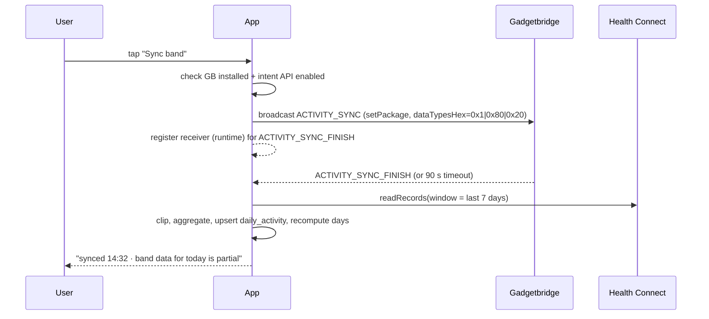

# Architecture

## 1. Stack (versions checked 2026-11-07)

| Layer | Choice | Version | Note |
| --- | --- | --- | --- |
| Language | Kotlin | 2.2.x | K2, `kotlinx-datetime` for dates |
| UI | Jetpack Compose + Material 3 | BOM 2026.xx | Navigation Compose, no fragments |
| Min / target SDK | **28** / 36 | HC requires API 28 + Play services; the Android 11 phone is the floor. Below 28 the app is not offered | HC needs the HC app below API 34; we detect and explain |
| DI | Hilt | 2.5x | |
| Persistence | Room | 2.7.x | SQLite, FTS4 table for product search |
| Prefs | DataStore (Proto or Preferences) | 1.1.x | |
| Async | Coroutines + Flow | | |
| Background | WorkManager | 2.10.x | periodic HC sync, weekly TDEE, pending lookups |
| Health | `androidx.health.connect:connect-client` | **1.1.0** (1.2.0-alpha06 exists) | read-only in MVP |
| Camera | `androidx.camera:camera-camera2`, `camera-lifecycle`, `camera-view` | **1.6.2** (1.7.0-rc02 exists) | |
| Barcode | `io.github.zxing-cpp:android` | **3.1.1** | behind `BarcodeEngine` interface |
| Optional barcode | `com.google.mlkit:barcode-scanning` | **17.3.0** | `google` product flavour only |
| HTTP | OkHttp + kotlinx-serialization | 5.x / 1.9.x | no Retrofit needed for 3 endpoints |
| Charts | Vico or hand-rolled Canvas | | weight trend + bars |
| Testing | JUnit5, Turbine, Robolectric, Room in-memory, MockWebServer | | |
| Build | Gradle KTS + version catalog, `minifyEnabled` release | | |

Why native Kotlin and not Flutter/React Native: Health Connect, CameraX + zxing-cpp and the GB intent
API are all Android-native, the app is single-platform, and the calorie maths benefits from a small,
testable, strongly-typed core. Cross-platform buys nothing here.

## 2. Module layout

Start with three Gradle modules; split further only when build times hurt.

```
:app                 Compose UI, navigation, DI wiring, onboarding
:core                pure Kotlin: models, energy math, recipe math, unit conversion, day bucketing
:data                Room, Health Connect client, OFF client, Gadgetbridge intents, repositories
```

Package sketch inside `:data`:

```
data/
  db/            AppDatabase, DAOs, entities, migrations
  health/        HealthConnectDataSource, HealthPermissions, HcMapper
  gadgetbridge/  GadgetbridgeBridge (intents), GbStatus
  off/           OffApi, OffDto, OffMapper, ProductRepository, OffRateLimiter
  barcode/       BarcodeEngine (interface), ZxingCppEngine, MlKitEngine
  settings/      SettingsRepository (DataStore)
  export/        JsonExporter, CsvExporter, Importer
```

`:core` must have **zero Android imports** so the maths is testable on the JVM and reusable later.

## 3. Data model

SQLite/Room, all timestamps UTC epoch-millis, all dates as `local_date TEXT` (`YYYY-MM-DD`) computed
with the profile's zone at write time.

```sql
CREATE TABLE profile (
  id INTEGER PRIMARY KEY,
  name TEXT NOT NULL,
  sex TEXT NOT NULL CHECK (sex IN ('male','female')),
  birth_date TEXT NOT NULL,
  height_cm REAL NOT NULL,
  activity_level TEXT NOT NULL,          -- sedentary|light|moderate|hard|athlete
  goal_rate_kg_per_week REAL NOT NULL,   -- negative = lose
  target_kcal_override INTEGER,          -- nullable, user pinned a number
  band_enabled INTEGER NOT NULL DEFAULT 0, -- 1 = this phone's Health Connect belongs to this profile
  band_label TEXT,                       -- "Huawei Band 9" for display only
  day_start_hour INTEGER NOT NULL DEFAULT 4,
  unit_system TEXT NOT NULL DEFAULT 'metric',
  created_at INTEGER NOT NULL,
  archived_at INTEGER
);

CREATE TABLE body_measurement (
  id INTEGER PRIMARY KEY,
  profile_id INTEGER NOT NULL REFERENCES profile(id),
  measured_at INTEGER NOT NULL,
  local_date TEXT NOT NULL,
  weight_kg REAL,
  body_fat_pct REAL,
  source TEXT NOT NULL,                  -- manual|health_connect|gadgetbridge|scale
  UNIQUE(profile_id, measured_at, source)
);
CREATE INDEX idx_bm_profile_date ON body_measurement(profile_id, local_date);

CREATE TABLE daily_activity (            -- one row per profile per local day
  profile_id INTEGER NOT NULL,
  local_date TEXT NOT NULL,
  steps INTEGER,
  active_kcal REAL,
  bmr_kcal REAL,                         -- as reported, null if absent
  total_kcal REAL,                       -- as reported, null if absent
  distance_m REAL,
  sleep_minutes INTEGER,
  resting_hr INTEGER,
  quality TEXT NOT NULL,                 -- complete|partial|no_band|estimated
  updated_at INTEGER NOT NULL,
  PRIMARY KEY (profile_id, local_date)
);

CREATE TABLE product (
  id INTEGER PRIMARY KEY,
  barcode TEXT,                          -- null for user products without barcode
  name TEXT NOT NULL,
  brand TEXT,
  source TEXT NOT NULL,                  -- off|user|starter
  -- nutrition, always per 100 g (or 100 ml when is_liquid)
  kcal_100g REAL, protein_100g REAL, fat_100g REAL, carbs_100g REAL,
  fiber_100g REAL, sugar_100g REAL, salt_100g REAL,
  is_liquid INTEGER NOT NULL DEFAULT 0,
  serving_grams REAL,
  pack_grams REAL,
  image_url TEXT,
  off_rev INTEGER,                       -- OFF revision/updated timestamp when known
  is_override INTEGER NOT NULL DEFAULT 0,-- user corrected an OFF product
  energy_estimated INTEGER NOT NULL DEFAULT 0, -- kcal derived from macros
  created_at INTEGER NOT NULL,
  updated_at INTEGER NOT NULL
);
CREATE UNIQUE INDEX idx_product_barcode ON product(barcode) WHERE barcode IS NOT NULL;
CREATE VIRTUAL TABLE product_fts USING fts4(name, brand, content='product');

CREATE TABLE recipe (
  id INTEGER PRIMARY KEY,
  profile_id INTEGER NOT NULL,
  name TEXT NOT NULL,
  cooked_weight_g REAL,                  -- null => use raw sum
  servings REAL NOT NULL DEFAULT 1,
  notes TEXT,
  created_at INTEGER, updated_at INTEGER
);

CREATE TABLE recipe_item (
  recipe_id INTEGER NOT NULL REFERENCES recipe(id) ON DELETE CASCADE,
  product_id INTEGER NOT NULL REFERENCES product(id),
  grams REAL NOT NULL,
  position INTEGER NOT NULL
);

CREATE TABLE food_entry (
  id INTEGER PRIMARY KEY,
  profile_id INTEGER NOT NULL,
  consumed_at INTEGER NOT NULL,
  local_date TEXT NOT NULL,
  meal TEXT NOT NULL,                    -- breakfast|lunch|dinner|snack
  product_id INTEGER, recipe_id INTEGER,
  grams REAL NOT NULL,
  -- snapshot, never recomputed from product
  kcal REAL NOT NULL, protein_g REAL, fat_g REAL, carbs_g REAL,
  fiber_g REAL, sugar_g REAL, salt_g REAL,
  was_estimated INTEGER NOT NULL DEFAULT 0,
  note TEXT,
  deleted_at INTEGER
);
CREATE INDEX idx_entry_profile_date ON food_entry(profile_id, local_date) WHERE deleted_at IS NULL;

CREATE TABLE target_history (
  profile_id INTEGER NOT NULL,
  effective_from TEXT NOT NULL,
  kcal INTEGER NOT NULL,
  protein_g REAL, fat_g REAL, carbs_g REAL,
  tdee_kcal REAL, tdee_confidence TEXT,  -- none|low|medium|high
  mode TEXT NOT NULL,                    -- seed|adaptive|pinned
  PRIMARY KEY (profile_id, effective_from)
);

CREATE TABLE pending_lookup (barcode TEXT PRIMARY KEY, attempts INTEGER, last_error TEXT, created_at INTEGER);

CREATE TABLE sync_state (key TEXT PRIMARY KEY, last_success INTEGER, last_cursor TEXT);
```

Design rules:

- **Band data belongs to the phone.** `band_enabled = 1` on at most one profile per device. A profile
  with `band_enabled = 0` never reads Health Connect — it gets its burn from formula/PAL or from
  manual weight trend only. This is what makes the app "universal" without lying to a second user.
- **Snapshots everywhere it matters.** `food_entry` stores the nutrition it was logged with; editing a
  product or an OFF record cannot rewrite history.
- **One aggregate row per day**, upserted, recomputed from scratch whenever new HC data arrives. Cheap
  and idempotent.
- **Soft delete** for entries (`deleted_at`), hard purge after 30 days.

### 3.1 Room implementation notes (schema v1, 2026-11-08)

The SQL above is the intent; Room forces three mechanical differences, all recorded in
`BalanceCaloriesDatabase` as well:

| Intent | Room reality | Consequence |
| --- | --- | --- |
| `CHECK (sex IN ('male','female'))` | Room cannot declare CHECK constraints | `TypeConverters` map the enum to `male`/`female` and fail loudly on an unknown value instead of accepting it |
| `CREATE INDEX … ON food_entry(…) WHERE deleted_at IS NULL` | No partial-index support | Plain composite index on `(profile_id, local_date)`; negligible at one-person volume |
| `CREATE VIRTUAL TABLE product_fts USING fts4(…)` | Declared as `@Fts4(contentEntity = product)` | Room owns the sync triggers that the hand-written SQL would need explicitly |

Schemas are exported to `data/schemas/` and committed. `MigrationHarnessTest` replays the v1 JSON with
`MigrationTestHelper` on a device, so the harness exists before the first migration does; every future
version adds its migration test to that file.

**Schema v2 (2026-11-08)** adds `app_setting(key TEXT PRIMARY KEY, value TEXT NOT NULL)`, a small
key-value store for state that belongs to the phone rather than to a person. Its first key is
`active_profile_id`, which records *which* profile the app is showing. This is deliberately not inferred
from row order: with two profiles in a household, "the first row" would eventually show one person's
numbers under another's name. `ProfileRepository.delete` clears the key when the deleted profile was the
current one, so the stored selection can never point at a missing row.

## 4. Health Connect mapping

| HC record | Field | Destination |
| --- | --- | --- |
| `StepsRecord` | `count`, `startTime`/`endTime` | `daily_activity.steps` (sum clipped to local day) |
| `ActiveCaloriesBurnedRecord` | `energy.inKilocalories` | `daily_activity.active_kcal` |
| `BasalMetabolicRateRecord` | `basalMetabolicRate.inKilocaloriesPerDay` | `daily_activity.bmr_kcal` (time-weighted mean) |
| `TotalCaloriesBurnedRecord` | `energy` | `daily_activity.total_kcal` (cross-check only) |
| `WeightRecord` | `weight.inKilograms` | `body_measurement` (source=`health_connect`) |
| `SleepSessionRecord` | start/end | `daily_activity.sleep_minutes` (context only) |
| `ExerciseSessionRecord` | `totalEnergyBurned` | **ignored for the balance** (already inside active kcal) |

Read window: `[today-30d, now]` on first run, `[today-7d, now]` on every sync — overlapping windows
make the pull self-healing. Aggregation is done in Kotlin after clipping each record's interval to the
local-day boundary (a record spanning midnight contributes proportionally; for calories we use
time-weighted apportionment, which is the least-wrong option available).

Permissions requested: `READ_STEPS`, `READ_ACTIVE_CALORIES_BURNED`, `READ_BASAL_METABOLIC_RATE`,
`READ_TOTAL_CALORIES_BURNED`, `READ_WEIGHT`, `READ_SLEEP`, `READ_EXERCISE`. Request them as a group,
degrade gracefully: no `READ_BASAL_METABOLIC_RATE` → formula BMR; no `READ_WEIGHT` → manual weight only.

### 4.1 Android 11 specifics (Redmi Note 8 Pro)

The wife's phone is the constraint that shapes several decisions:

| Topic | Reality on Android 11 | What we do |
| --- | --- | --- |
| HC availability | Play Store APK, not system | `getSdkStatus()` → if `UNAVAILABLE`, deep-link to the Play listing and keep food logging usable |
| Permission UI | Hosted by the HC app, different look | Use `PermissionController.createRequestPermissionResultContract()` — same code path on both phones |
| History depth | HC exposes ~30 days before first grant; `READ_HEALTH_DATA_HISTORY` is API 34+ only ⚠ verify | Backfill 30 days, then grow forward; never promise "import your whole history" |
| Background | MIUI kills apps aggressively | WorkManager only, no long-running service; onboarding asks for Autostart + "no battery restrictions" |
| PendingIntent | `FLAG_IMMUTABLE` required (targetSdk 31+) | Set it in the GB bridge, otherwise a `IllegalArgumentException` at runtime |
| Package visibility | Android 11+ hides other apps from `getPackageInfo`/`queryIntent*` | Declare `<queries><package android:name="nodomain.freeyourgadget.gadgetbridge"/></queries>`; without it GB always looks "not installed" |
| Performance | Helio G90T, 2019 mid-range | Cap `ImageAnalysis` to 1280×720, `STRATEGY_KEEP_ONLY_LATEST`, no ML Kit flavour by default |
| Storage | 64/128 GB, user likely near full | Keep DB small (daily aggregates, not raw samples), vacuum on maintenance |

The same code must not assume Android 14 APIs anywhere: no `READ_HEALTH_DATA_HISTORY`, no
`HealthConnectManager` system-service assumptions, no notification-permission requirement (that is
33+, so simply absent here).

## 5. Flows

### 5.1 Band sync ("Sync band" button)



Notes: broadcasts are sent with `setPackage("nodomain.freeyourgadget.gadgetbridge")` (required on
Android 8+); the receiver is registered at runtime because implicit broadcasts no longer reach
manifest receivers; the timeout path is the normal path when GB's intent support misbehaves
(GB's own docs warn that not all devices implement the finish broadcast correctly).

### 5.2 Background sync

`PeriodicWorkRequest`, every 3 h, `NetworkType.NOT_REQUIRED`, `setRequiresBatteryNotLow(true)`,
expedited on app open. It does **not** trigger a GB sync (that would fight GB's own scheduler); it
only pulls HC. A separate weekly worker recomputes TDEE and rolls `target_history`.

### 5.3 Logging a scanned product

```
scan → normalise(digits, strip leading zeros?) → local cache hit?
   yes → Product screen (instant, offline)
   no  → single OFF GET → cache → Product screen
         404 → "not found" screen → manual product (barcode prefilled)
         429/5xx → queue in pending_lookup, "will resolve when online"
```

## 6. OpenFoodFacts client contract

- Base: `https://world.openfoodfacts.org`, path `/api/v3/product/{barcode}.json`, explicit `fields`
  list so payloads stay small.
- `User-Agent: BalanceCalories/{version} ({contact})` — mandatory, set once in an interceptor.
- Client-side token bucket: **≤ 12 product reads/min** (margin under the 15/min server limit),
  ≤ 8 search calls/min, single-flight per barcode, exponential backoff with jitter on 429/5xx
  (1 s, 2 s, 4 s, 8 s, max 3 attempts).
- Cache policy: successful lookups cached indefinitely (OFF data is stable enough); a stale product
  can be refreshed by an explicit pull-to-refresh on the product screen, never automatically.
- `404` is a *result*, cached as "unknown product" for 30 days to avoid re-hitting the API.
- Response → `product` mapping rules: prefer `energy-kcal_100g`; else `energy-kj_100g / 4.184`; else
  `4P + 4C + 9F` with `energy_estimated = 1`; ignore `*_prepared` and `nutriments_estimated` for the
  maths; parse `serving_size` ("30 g", "1 bar (25 g)") conservatively — only accept a clean
  `number + unit` pattern, otherwise leave `serving_grams` null.
- Attribution string + licence link on the product screen and in settings.

## 7. Barcode pipeline

```kotlin
interface BarcodeEngine {                 // :data
    suspend fun analyze(image: ImageProxy): String?   // EAN-13/8, UPC-A/E only
}
class ZxingCppEngine : BarcodeEngine      // default, Apache-2.0
class MlKitEngine : BarcodeEngine         // 'google' flavour
```

Rules: continuous analysis at ~10 fps with `STRATEGY_KEEP_ONLY_LATEST`; debounce the same code for
2 s; require a valid check digit before accepting; vibrate + beep + freeze frame on success; torch
toggle; manual entry always available; camera permission requested only when the scanner opens, with
a rationale screen.

## 8. Algorithms

### 8.1 Day bucketing

```kotlin
fun localDateOf(instant: Instant, zone: ZoneId, dayStartHour: Int): LocalDate {
    val shifted = instant.atZone(zone).minusHours(dayStartHour.toLong())
    return shifted.toLocalDate()
}
```
Used for every write. Because it is a pure function, DST transitions and 04:00 rollover are unit-tested.

### 8.2 Energy out

```
burned(day) =
    if (activity.bmr_kcal != null) activity.bmr_kcal
    else mifflin(profile, weightOn(day))

  + if (activity.quality != no_band) activity.active_kcal else restOfDayEstimate
```

`restOfDayEstimate` is used only for `no_band` days: `mifflin × PAL − mifflin` (i.e. PAL-based total
minus BMR), and the day is flagged `estimated` so it never enters the TDEE window.

### 8.3 Target (ADR-004: fixed daily target)

```
seed:      tdee0  = mifflin(profile, currentWeight) × PAL(profile.activityLevel)
           target = tdee0 × (1 − deficitPct)          // deficitPct from goal_rate_kg_per_week
adaptive:  tdee   = blend(tdee_hat, tdee_band)        // see research §5.4
           target = tdee × (1 − deficitPct)
floors:    target = max(target, 1.1 × bmr, 1200 if female else 1500)
caps:      deficitPct ≤ 0.25;  |Δtarget| ≤ 5% per week
```

`deficitPct` is derived from the goal rate: `deficitPct = goal_rate_kg_per_week × 7700 / 7 / tdee`,
clamped. The UI exposes *rate* ("−0.5 kg/week"), not percentages — it is the number people understand.

### 8.4 Adaptive TDEE (v1.1)

```
window      = last 28 days, step weekly, require ≥10 logged days and ≥4 weight points
trendWeight = EWMA(weight, alpha = 0.25)              // per-weigh-in
ΔW          = trendWeight(last) − trendWeight(firstOfWindow)
tdee_hat    = meanIntake − ΔW × 7700 / days
tdee_band   = mean(bmr + active) over complete days in window
tdee        = 0.5 tdee_hat + 0.5 tdee_band
confidence  = high if ≥21 logged days & ≥8 weigh-ins, medium if ≥14 & ≥5, else low
```

Excluded from `meanIntake`: days with <60% meal completeness, days flagged `estimated`, and the first
7 days of any new diet (glycogen/water). If `|tdee − previous| > 5%`, clamp and surface "we limited
this week's adjustment".

### 8.5 Recipe maths

```
totalKcal   = Σ(item.grams × product.kcal_100g / 100)
totalWeight = cooked_weight_g ?: Σ(item.grams)
per100g     = totalKcal / totalWeight × 100
serving     = totalKcal / servings
loggedKcal  = grams × per100g / 100
```

Stored as a derived cache on `recipe` (not a column in `food_entry`, which keeps its own snapshot).
Warning shown when any component has `energy_estimated = 1`.

### 8.6 Rounding

Store full `REAL`; round only at render: kcal → integer, grams → 0.1, weight → 0.1 kg. Never round an
intermediate used by another computation.

## 9. Edge cases (each one is a test)

| Case | Handling |
| --- | --- |
| Band not worn / forgotten at home | `no_band` day, PAL estimate, excluded from TDEE |
| Band synced but only half a day | `partial`, recomputed later on upsert |
| Second profile on a band-equipped phone | `band_enabled = 0` forced, burn from PAL, banner explains why |
| Health Connect app missing (Android 11) | Onboarding offers install; food-only mode, band features hidden with a reason |
| Phone replaced | Profile + history via export/import; HC history stays on the old phone; band re-paired in GB |
| Two bands on one phone | Detected at onboarding (multiple GB devices): warn that HC merges them, refuse to mix profiles |
| Timezone travel | Day bucketing uses current zone; a "day" may be 23/25 h; chart shows the discontinuity |
| Midnight-crossing workout | Proportional split by interval overlap |
| Entry edited after a week | Recompute that day only; history of other days untouched |
| OFF product deleted upstream | Cached copy keeps working; refresh yields 404 → keep local copy, mark stale |
| Weight spike (salt/alcohol) | EWMA absorbs it; never adjust target from a single weigh-in |
| Zero/negative grams | Input validation, no silent 0-kcal entries |
| Huge portion (3 kg typo) | Soft warning above 3× serving/pack |
| HC permission revoked mid-use | Detect on read, show a single non-blocking banner, keep food logging functional |
| GB not installed | Onboarding shows "install Gadgetbridge" with a link; app works in manual mode |
| Device clock wrong | All day maths uses UTC instants from HC and local zone; a clock jump only affects "today" |

## 10. Testing strategy

- `:core` — pure JVM unit tests: formula vectors (Mifflin male/female, PAL, deficit clamp, floors),
  day bucketing across DST, recipe scaling, EWMA, TDEE guards. Target: **>90% line coverage** here.
- `:data` — MockWebServer golden tests for OFF (success, 404, 429, malformed JSON, kJ-only, serving
  strings); Room DAO tests on in-memory DB incl. migrations; fake `HealthConnectDataSource` for
  aggregation tests (midnight split, late data, missing BMR).
- UI — 6 Compose screenshot/behaviour tests for the critical flows (log, scan, day, target change).
- Manual — a "data-health" debug screen showing raw HC records next to our aggregates; used during
  the spike and kept behind a debug flag.

## 11. Privacy & security

- No backend, no account, no analytics, no crash reporting by default.
- `android:allowBackup="false"` and `dataExtractionRules` excluding the DB — health data must not end
  up in Google's cloud backup.
- Network security config: cleartext disabled; only `*.openfoodfacts.org` contacted (plus the
  optional image CDN, which we can skip by not loading product images in v1).
- Only permissions: `INTERNET`, `CAMERA`, HC health permissions. No location, no Bluetooth, no
  contacts.
- Export files are written through SAF at the user's chosen location; a debug-only encrypted backup
  (SQLCipher) is optional later.
- Disclaimer on first launch and in settings: not a medical device, estimates only.

## 12. i18n, accessibility, distribution

- Strings in `values/` (en) + `values-ru/`; no concatenated sentences; plurals via `plurals`.
- Numbers/dates via `Locale`-aware formatters; `java.time`/`kotlinx-datetime` only.
- TalkBack labels for the balance card, macro rings and scanner overlay; min touch target 48 dp.
- Two product flavours: `foss` (zxing-cpp only, F-Droid friendly) and `google` (adds ML Kit). Same code,
  different `BarcodeEngine` binding.

## 13. Decisions (ADRs)

| ID | Decision | Alternatives rejected | Consequence |
| --- | --- | --- | --- |
| ADR-001 | Health Connect as the band data source | GB DB export (unreadable), GB ContentProvider (none), direct BLE (years of work) | Requires GB + HC setup; data may lag |
| ADR-002 | Native Kotlin | Flutter, RN | Single platform, best API access |
| ADR-003 | zxing-cpp default, ML Kit optional | ML Kit only (proprietary), ZXing-embedded (weaker) | Two flavours to build |
| ADR-004 | Fixed daily target, exercise not added back | Dynamic "eat back" | Stable UX; unusual days handled manually |
| ADR-005 | Snapshot nutrition in entries | Live join to product | Slightly more storage, correct history |
| ADR-006 | One local Room DB, no sync | Cloud sync between phones | Two independent phones; shared data via export only |
| ADR-007 | Room + FTS4 for product search | Bundled OFF dump (300 MB+) | Search hits the network only on explicit action |
| ADR-008 | Profiles are rows; `band_enabled` is per profile, one per device | Hardcoding the two users; one profile per install | App works for any household; second profile cannot accidentally inherit calories |
| ADR-009 | A starter ingredient pack ships as a generated JSON asset | Bundling OFF extract (ODbL, size); name search for every vegetable | Cooking flow works on day one; pack is editable and deletable like user data. **Shipped with 69 items, not ~150** (2026-11-08): fewer entries we can defend against composition tables beat more entries guessed, and the pack grows from user entries and OFF lookups |
| ADR-010 | Display name is **Balance Calories** / **Баланс Калорий**; the repo, packages and `applicationId` stay `BalanceCalories` / `com.balancecalories` | Renaming the module or package to match the label | Launcher labels read naturally in both languages; no code churn, no Play identity change |
| ADR-011 | Two languages from the start, English default and Russian complete; the UI follows the system locale, with an in-app switch deferred to settings | English-only until later, machine translation | Every new string lands in both files together, enforced by a unit test rather than discipline |
| ADR-012 | Deleting a profile is a **hard delete** with a foreign-key cascade, behind a confirmation that names the profile and lists what disappears; `archived_at` remains for hiding without destroying | Soft delete only; keeping orphaned rows | The user can genuinely start over, and "delete" means what it says. The cost is that it cannot be undone, so the dialog spells that out and the archive path exists for the reversible case |
| ADR-013 | OpenFoodFacts is read over **`HttpURLConnection` with `org.json`**, not OkHttp/Retrofit/kotlinx-serialization; the client validates barcodes locally, throttles itself to one request per 6 s, retries only network errors/429/5xx (three attempts), and treats 404 as a cached answer | Adding an HTTP client + serialization stack for three GETs; a token bucket tuned to a published quota | No new shipping dependency; the retry/404 logic is testable through an injected transport. OFF publishes no rate-limit headers, so the pace is our choice, not a measurement. Revisit if we ever need interceptors, HTTP/2 or streaming |
| ADR-014 | The client speaks **v3** and the parser accepts **v2's shape too** | v2 only (it works today, but is the legacy endpoint); v3 only (a cached or proxied v2 answer would read as missing) | One code path survives either version. The difference is the status field: v3 says `"success"`, v2 says `1` |
| ADR-015 | `pending_lookup` holds **both** the offline retry queue and cached 404s, separated by the `not_found` marker in `last_error` | A second table for cached misses | One life cycle instead of two that can disagree: both are cleared when the barcode resolves, and a cached miss is never turned into a retry job. The trade-off is that `last_error` carries a sentinel value, documented at the DAO |
| ADR-016 | A food entry snapshots the product's **name** as well as its nutrition (schema v4) | Joining `product` at read time; storing only `product_id` | Extends ADR-005 to the label: a deleted or renamed product cannot make yesterday's plate unreadable or rewrite what it was called. Costs two nullable columns per entry |
| ADR-017 | Barcodes are decoded by **zxing-cpp 3.1.1** (`io.github.zxing-cpp:android`), behind a `BarcodeScanner` interface so the engine can be swapped per flavour; CameraX is pinned at **1.6.2** | ML Kit (9.9 MB, still pulls Play services, no release since 2024-08), ZXing Android Embedded (slower, Java), Google Code Scanner (no overlay, needs Play) | FOSS, offline, Apache-2.0, 2.9 MB with four ABIs, `minSdk 21`, built on **Kotlin 2.3.20** like this project, and its native libraries are **16 KB-page aligned** — checked, not assumed. The cost is JNI and a native crash surface, contained behind one interface |
