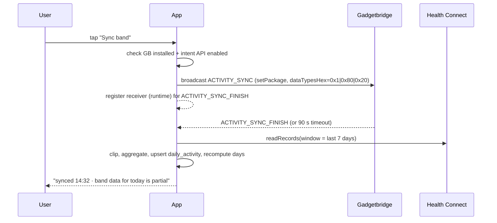

# Architecture

## 1. Stack (versions checked 2026-11-07)

| Layer | Choice | Version | Note |
| --- | --- | --- | --- |
| Language | Kotlin | 2.2.x | K2, `kotlinx-datetime` for dates |
| UI | Jetpack Compose + Material 3 | BOM 2026.xx | Navigation Compose, no fragments |
| Min / target SDK | **28** / 36 | HC requires API 28 + Play services; the Android 11 phone is the floor. Below 28 the app is not offered | HC needs the HC app below API 34; we detect and explain |
| DI | Hilt | 2.5x | |
| Persistence | Room | 2.7.x | SQLite, FTS4 table for product search |
| Prefs | DataStore (Proto or Preferences) | 1.1.x | |
| Async | Coroutines + Flow | | |
| Background | WorkManager | 2.10.x | periodic HC sync, weekly TDEE, pending lookups |
| Health | `androidx.health.connect:connect-client` | **1.1.0** (1.2.0-alpha06 exists) | read-only in MVP |
| Camera | `androidx.camera:camera-camera2`, `camera-lifecycle`, `camera-view` | **1.6.2** (1.7.0-rc02 exists) | |
| Barcode | `io.github.zxing-cpp:android` | **3.1.1** | behind `BarcodeEngine` interface |
| Optional barcode | `com.google.mlkit:barcode-scanning` | **17.3.0** | `google` product flavour only |
| HTTP | OkHttp + kotlinx-serialization | 5.x / 1.9.x | no Retrofit needed for 3 endpoints |
| Charts | Vico or hand-rolled Canvas | | weight trend + bars |
| Testing | JUnit5, Turbine, Robolectric, Room in-memory, MockWebServer | | |
| Build | Gradle KTS + version catalog, `minifyEnabled` release | | |

Why native Kotlin and not Flutter/React Native: Health Connect, CameraX + zxing-cpp and the GB intent
API are all Android-native, the app is single-platform, and the calorie maths benefits from a small,
testable, strongly-typed core. Cross-platform buys nothing here.

## 2. Module layout

Start with three Gradle modules; split further only when build times hurt.

```
:app                 Compose UI, navigation, DI wiring, onboarding
:core                pure Kotlin: models, energy math, recipe math, unit conversion, day bucketing
:data                Room, Health Connect client, OFF client, Gadgetbridge intents, repositories
```

Package sketch inside `:data`:

```
data/
  db/            AppDatabase, DAOs, entities, migrations
  health/        HealthConnectDataSource, HealthPermissions, HcMapper
  gadgetbridge/  GadgetbridgeBridge (intents), GbStatus
  off/           OffApi, OffDto, OffMapper, ProductRepository, OffRateLimiter
  barcode/       BarcodeEngine (interface), ZxingCppEngine, MlKitEngine
  settings/      SettingsRepository (DataStore)
  export/        JsonExporter, CsvExporter, Importer
```

`:core` must have **zero Android imports** so the maths is testable on the JVM and reusable later.

## 3. Data model

SQLite/Room, all timestamps UTC epoch-millis, all dates as `local_date TEXT` (`YYYY-MM-DD`) computed
with the profile's zone at write time.

```sql
CREATE TABLE profile (
  id INTEGER PRIMARY KEY,
  name TEXT NOT NULL,
  sex TEXT NOT NULL CHECK (sex IN ('male','female')),
  birth_date TEXT NOT NULL,
  height_cm REAL NOT NULL,
  activity_level TEXT NOT NULL,          -- sedentary|light|moderate|hard|athlete
  goal_rate_kg_per_week REAL NOT NULL,   -- negative = lose
  target_kcal_override INTEGER,          -- nullable, user pinned a number
  band_enabled INTEGER NOT NULL DEFAULT 0, -- 1 = this phone's Health Connect belongs to this profile
  band_label TEXT,                       -- "Huawei Band 9" for display only
  day_start_hour INTEGER NOT NULL DEFAULT 4,
  unit_system TEXT NOT NULL DEFAULT 'metric',
  created_at INTEGER NOT NULL,
  archived_at INTEGER
);

CREATE TABLE body_measurement (
  id INTEGER PRIMARY KEY,
  profile_id INTEGER NOT NULL REFERENCES profile(id),
  measured_at INTEGER NOT NULL,
  local_date TEXT NOT NULL,
  weight_kg REAL,
  body_fat_pct REAL,
  source TEXT NOT NULL,                  -- manual|health_connect|gadgetbridge|scale
  UNIQUE(profile_id, measured_at, source)
);
CREATE INDEX idx_bm_profile_date ON body_measurement(profile_id, local_date);

CREATE TABLE daily_activity (            -- one row per profile per local day
  profile_id INTEGER NOT NULL,
  local_date TEXT NOT NULL,
  steps INTEGER,
  active_kcal REAL,
  bmr_kcal REAL,                         -- as reported, null if absent
  total_kcal REAL,                       -- as reported, null if absent
  distance_m REAL,
  sleep_minutes INTEGER,
  resting_hr INTEGER,
  quality TEXT NOT NULL,                 -- complete|partial|no_band|estimated
  updated_at INTEGER NOT NULL,
  PRIMARY KEY (profile_id, local_date)
);

CREATE TABLE product (
  id INTEGER PRIMARY KEY,
  barcode TEXT,                          -- null for user products without barcode
  name TEXT NOT NULL,
  brand TEXT,
  source TEXT NOT NULL,                  -- off|user|starter
  -- nutrition, always per 100 g (or 100 ml when is_liquid)
  kcal_100g REAL, protein_100g REAL, fat_100g REAL, carbs_100g REAL,
  fiber_100g REAL, sugar_100g REAL, salt_100g REAL,
  is_liquid INTEGER NOT NULL DEFAULT 0,
  serving_grams REAL,
  pack_grams REAL,
  image_url TEXT,
  off_rev INTEGER,                       -- OFF revision/updated timestamp when known
  is_override INTEGER NOT NULL DEFAULT 0,-- user corrected an OFF product
  energy_estimated INTEGER NOT NULL DEFAULT 0, -- kcal derived from macros
  created_at INTEGER NOT NULL,
  updated_at INTEGER NOT NULL
);
CREATE UNIQUE INDEX idx_product_barcode ON product(barcode) WHERE barcode IS NOT NULL;
CREATE VIRTUAL TABLE product_fts USING fts4(name, brand, content='product');

CREATE TABLE recipe (
  id INTEGER PRIMARY KEY,
  profile_id INTEGER NOT NULL,
  name TEXT NOT NULL,
  cooked_weight_g REAL,                  -- null => use raw sum
  servings REAL NOT NULL DEFAULT 1,
  notes TEXT,
  created_at INTEGER, updated_at INTEGER
);

CREATE TABLE recipe_item (
  recipe_id INTEGER NOT NULL REFERENCES recipe(id) ON DELETE CASCADE,
  product_id INTEGER NOT NULL REFERENCES product(id),
  grams REAL NOT NULL,
  position INTEGER NOT NULL
);

CREATE TABLE food_entry (
  id INTEGER PRIMARY KEY,
  profile_id INTEGER NOT NULL,
  consumed_at INTEGER NOT NULL,
  local_date TEXT NOT NULL,
  meal TEXT NOT NULL,                    -- breakfast|lunch|dinner|snack
  product_id INTEGER, recipe_id INTEGER,
  grams REAL NOT NULL,
  -- snapshot, never recomputed from product
  kcal REAL NOT NULL, protein_g REAL, fat_g REAL, carbs_g REAL,
  fiber_g REAL, sugar_g REAL, salt_g REAL,
  was_estimated INTEGER NOT NULL DEFAULT 0,
  note TEXT,
  deleted_at INTEGER
);
CREATE INDEX idx_entry_profile_date ON food_entry(profile_id, local_date) WHERE deleted_at IS NULL;

CREATE TABLE target_history (
  profile_id INTEGER NOT NULL,
  effective_from TEXT NOT NULL,
  kcal INTEGER NOT NULL,
  protein_g REAL, fat_g REAL, carbs_g REAL,
  tdee_kcal REAL, tdee_confidence TEXT,  -- none|low|medium|high
  mode TEXT NOT NULL,                    -- seed|adaptive|pinned
  PRIMARY KEY (profile_id, effective_from)
);

CREATE TABLE pending_lookup (barcode TEXT PRIMARY KEY, attempts INTEGER, last_error TEXT, created_at INTEGER);

CREATE TABLE sync_state (key TEXT PRIMARY KEY, last_success INTEGER, last_cursor TEXT);
```

Design rules:

- **Band data belongs to the phone.** `band_enabled = 1` on at most one profile per device. A profile
  with `band_enabled = 0` never reads Health Connect — it gets its burn from formula/PAL or from
  manual weight trend only. This is what makes the app "universal" without lying to a second user.
- **Snapshots everywhere it matters.** `food_entry` stores the nutrition it was logged with; editing a
  product or an OFF record cannot rewrite history.
- **One aggregate row per day**, upserted, recomputed from scratch whenever new HC data arrives. Cheap
  and idempotent.
- **Soft delete** for entries (`deleted_at`), hard purge after 30 days.

### 3.1 Room implementation notes (schema v1, 2026-11-08)

The SQL above is the intent; Room forces three mechanical differences, all recorded in
`BalanceCaloriesDatabase` as well:

| Intent | Room reality | Consequence |
| --- | --- | --- |
| `CHECK (sex IN ('male','female'))` | Room cannot declare CHECK constraints | `TypeConverters` map the enum to `male`/`female` and fail loudly on an unknown value instead of accepting it |
| `CREATE INDEX … ON food_entry(…) WHERE deleted_at IS NULL` | No partial-index support | Plain composite index on `(profile_id, local_date)`; negligible at one-person volume |
| `CREATE VIRTUAL TABLE product_fts USING fts4(…)` | Declared as `@Fts4(contentEntity = product)` | Room owns the sync triggers that the hand-written SQL would need explicitly |

Schemas are exported to `data/schemas/` and committed. `MigrationHarnessTest` replays the v1 JSON with
`MigrationTestHelper` on a device, so the harness exists before the first migration does; every future
version adds its migration test to that file.

**Schema v2 (2026-11-08)** adds `app_setting(key TEXT PRIMARY KEY, value TEXT NOT NULL)`, a small
key-value store for state that belongs to the phone rather than to a person. Its first key is
`active_profile_id`, which records *which* profile the app is showing. This is deliberately not inferred
from row order: with two profiles in a household, "the first row" would eventually show one person's
numbers under another's name. `ProfileRepository.delete` clears the key when the deleted profile was the
current one, so the stored selection can never point at a missing row.

## 4. Health Connect mapping

| HC record | Field | Destination |
| --- | --- | --- |
| `StepsRecord` | `count`, `startTime`/`endTime` | `daily_activity.steps` (sum clipped to local day) |
| `ActiveCaloriesBurnedRecord` | `energy.inKilocalories` | `daily_activity.active_kcal` |
| `BasalMetabolicRateRecord` | `basalMetabolicRate.inKilocaloriesPerDay` | `daily_activity.bmr_kcal` (time-weighted mean) |
| `TotalCaloriesBurnedRecord` | `energy` | `daily_activity.total_kcal` (cross-check only) |
| `WeightRecord` | `weight.inKilograms` | `body_measurement` (source=`health_connect`) |
| `SleepSessionRecord` | start/end | `daily_activity.sleep_minutes` (context only) |
| `ExerciseSessionRecord` | `totalEnergyBurned` | **ignored for the balance** (already inside active kcal) |

Read window: `[today-30d, now]` on first run, `[today-7d, now]` on every sync — overlapping windows
make the pull self-healing. Aggregation is done in Kotlin after clipping each record's interval to the
local-day boundary (a record spanning midnight contributes proportionally; for calories we use
time-weighted apportionment, which is the least-wrong option available).

Permissions requested: `READ_STEPS`, `READ_ACTIVE_CALORIES_BURNED`, `READ_BASAL_METABOLIC_RATE`,
`READ_TOTAL_CALORIES_BURNED`, `READ_WEIGHT`, `READ_SLEEP`, `READ_EXERCISE`. Request them as a group,
degrade gracefully: no `READ_BASAL_METABOLIC_RATE` → formula BMR; no `READ_WEIGHT` → manual weight only.

### 4.1 Android 11 specifics (Redmi Note 8 Pro)

The wife's phone is the constraint that shapes several decisions:

| Topic | Reality on Android 11 | What we do |
| --- | --- | --- |
| HC availability | Play Store APK, not system | `getSdkStatus()` → if `UNAVAILABLE`, deep-link to the Play listing and keep food logging usable |
| Permission UI | Hosted by the HC app, different look | Use `PermissionController.createRequestPermissionResultContract()` — same code path on both phones |
| History depth | HC exposes ~30 days before first grant; `READ_HEALTH_DATA_HISTORY` is API 34+ only ⚠ verify | Backfill 30 days, then grow forward; never promise "import your whole history" |
| Background | MIUI kills apps aggressively | WorkManager only, no long-running service; onboarding asks for Autostart + "no battery restrictions" |
| PendingIntent | `FLAG_IMMUTABLE` required (targetSdk 31+) | Set it in the GB bridge, otherwise a `IllegalArgumentException` at runtime |
| Package visibility | Android 11+ hides other apps from `getPackageInfo`/`queryIntent*` | Declare `<queries><package android:name="nodomain.freeyourgadget.gadgetbridge"/></queries>`; without it GB always looks "not installed" |
| Performance | Helio G90T, 2019 mid-range | Cap `ImageAnalysis` to 1280×720, `STRATEGY_KEEP_ONLY_LATEST`, no ML Kit flavour by default |
| Storage | 64/128 GB, user likely near full | Keep DB small (daily aggregates, not raw samples), vacuum on maintenance |

The same code must not assume Android 14 APIs anywhere: no `READ_HEALTH_DATA_HISTORY`, no
`HealthConnectManager` system-service assumptions, no notification-permission requirement (that is
33+, so simply absent here).

## 5. Flows

### 5.1 Band sync ("Sync band" button)



Notes: broadcasts are sent with `setPackage("nodomain.freeyourgadget.gadgetbridge")` (required on
Android 8+); the receiver is registered at runtime because implicit broadcasts no longer reach
manifest receivers; the timeout path is the normal path when GB's intent support misbehaves
(GB's own docs warn that not all devices implement the finish broadcast correctly).

### 5.2 Background sync

`PeriodicWorkRequest`, every 3 h, `NetworkType.NOT_REQUIRED`, `setRequiresBatteryNotLow(true)`,
expedited on app open. It does **not** trigger a GB sync (that would fight GB's own scheduler); it
only pulls HC. A separate weekly worker recomputes TDEE and rolls `target_history`.

### 5.3 Logging a scanned product

```
scan → normalise(digits, strip leading zeros?) → local cache hit?
   yes → Product screen (instant, offline)
   no  → single OFF GET → cache → Product screen
         404 → "not found" screen → manual product (barcode prefilled)
         429/5xx → queue in pending_lookup, "will resolve when online"
```

## 6. OpenFoodFacts client contract

- Base: `https://world.openfoodfacts.org`, path `/api/v3/product/{barcode}.json`, explicit `fields`
  list so payloads stay small.
- `User-Agent: BalanceCalories/{version} ({contact})` — mandatory, set once in an interceptor.
- Client-side token bucket: **≤ 12 product reads/min** (margin under the 15/min server limit),
  ≤ 8 search calls/min, single-flight per barcode, exponential backoff with jitter on 429/5xx
  (1 s, 2 s, 4 s, 8 s, max 3 attempts).
- Cache policy: successful lookups cached indefinitely (OFF data is stable enough); a stale product
  can be refreshed by an explicit pull-to-refresh on the product screen, never automatically.
- `404` is a *result*, cached as "unknown product" for 30 days to avoid re-hitting the API.
- Response → `product` mapping rules: prefer `energy-kcal_100g`; else `energy-kj_100g / 4.184`; else
  `4P + 4C + 9F` with `energy_estimated = 1`; ignore `*_prepared` and `nutriments_estimated` for the
  maths; parse `serving_size` ("30 g", "1 bar (25 g)") conservatively — only accept a clean
  `number + unit` pattern, otherwise leave `serving_grams` null.
- Attribution string + licence link on the product screen and in settings.

## 7. Barcode pipeline

```kotlin
interface BarcodeEngine {                 // :data
    suspend fun analyze(image: ImageProxy): String?   // EAN-13/8, UPC-A/E only
}
class ZxingCppEngine : BarcodeEngine      // default, Apache-2.0
class MlKitEngine : BarcodeEngine         // 'google' flavour
```

Rules: continuous analysis at ~10 fps with `STRATEGY_KEEP_ONLY_LATEST`; debounce the same code for
2 s; require a valid check digit before accepting; vibrate + beep + freeze frame on success; torch
toggle; manual entry always available; camera permission requested only when the scanner opens, with
a rationale screen.

## 8. Algorithms

### 8.1 Day bucketing

```kotlin
fun localDateOf(instant: Instant, zone: ZoneId, dayStartHour: Int): LocalDate {
    val shifted = instant.atZone(zone).minusHours(dayStartHour.toLong())
    return shifted.toLocalDate()
}
```
Used for every write. Because it is a pure function, DST transitions and 04:00 rollover are unit-tested.

### 8.2 Energy out

```
burned(day) =
    if (activity.bmr_kcal != null) activity.bmr_kcal
    else mifflin(profile, weightOn(day))

  + if (activity.quality != no_band) activity.active_kcal else restOfDayEstimate
```

`restOfDayEstimate` is used only for `no_band` days: `mifflin × PAL − mifflin` (i.e. PAL-based total
minus BMR), and the day is flagged `estimated` so it never enters the TDEE window.

### 8.3 Target (ADR-004: fixed daily target)

```
seed:      tdee0  = mifflin(profile, currentWeight) × PAL(profile.activityLevel)
           target = tdee0 × (1 − deficitPct)          // deficitPct from goal_rate_kg_per_week
adaptive:  tdee   = blend(tdee_hat, tdee_band)        // see research §5.4
           target = tdee × (1 − deficitPct)
floors:    target = max(target, 1.1 × bmr, 1200 if female else 1500)
caps:      deficitPct ≤ 0.25;  |Δtarget| ≤ 5% per week
```

`deficitPct` is derived from the goal rate: `deficitPct = goal_rate_kg_per_week × 7700 / 7 / tdee`,
clamped. The UI exposes *rate* ("−0.5 kg/week"), not percentages — it is the number people understand.

### 8.4 Adaptive TDEE (v1.1)

```
window      = last 28 days, step weekly, require ≥10 logged days and ≥4 weight points
trendWeight = EWMA(weight, alpha = 0.25)              // per-weigh-in
ΔW          = trendWeight(last) − trendWeight(firstOfWindow)
tdee_hat    = meanIntake − ΔW × 7700 / days
tdee_band   = mean(bmr + active) over complete days in window
tdee        = 0.5 tdee_hat + 0.5 tdee_band
confidence  = high if ≥21 logged days & ≥8 weigh-ins, medium if ≥14 & ≥5, else low
```

Excluded from `meanIntake`: days with <60% meal completeness, days flagged `estimated`, and the first
7 days of any new diet (glycogen/water). If `|tdee − previous| > 5%`, clamp and surface "we limited
this week's adjustment".

### 8.5 Recipe maths

```
totalKcal   = Σ(item.grams × product.kcal_100g / 100)
totalWeight = cooked_weight_g ?: Σ(item.grams)
per100g     = totalKcal / totalWeight × 100
serving     = totalKcal / servings
loggedKcal  = grams × per100g / 100
```

Stored as a derived cache on `recipe` (not a column in `food_entry`, which keeps its own snapshot).
Warning shown when any component has `energy_estimated = 1`.

### 8.6 Rounding

Store full `REAL`; round only at render: kcal → integer, grams → 0.1, weight → 0.1 kg. Never round an
intermediate used by another computation.

## 9. Edge cases (each one is a test)

| Case | Handling |
| --- | --- |
| Band not worn / forgotten at home | `no_band` day, PAL estimate, excluded from TDEE |
| Band synced but only half a day | `partial`, recomputed later on upsert |
| Second profile on a band-equipped phone | `band_enabled = 0` forced, burn from PAL, banner explains why |
| Health Connect app missing (Android 11) | Onboarding offers install; food-only mode, band features hidden with a reason |
| Phone replaced | Profile + history via export/import; HC history stays on the old phone; band re-paired in GB |
| Two bands on one phone | Detected at onboarding (multiple GB devices): warn that HC merges them, refuse to mix profiles |
| Timezone travel | Day bucketing uses current zone; a "day" may be 23/25 h; chart shows the discontinuity |
| Midnight-crossing workout | Proportional split by interval overlap |
| Entry edited after a week | Recompute that day only; history of other days untouched |
| OFF product deleted upstream | Cached copy keeps working; refresh yields 404 → keep local copy, mark stale |
| Weight spike (salt/alcohol) | EWMA absorbs it; never adjust target from a single weigh-in |
| Zero/negative grams | Input validation, no silent 0-kcal entries |
| Huge portion (3 kg typo) | Soft warning above 3× serving/pack |
| HC permission revoked mid-use | Detect on read, show a single non-blocking banner, keep food logging functional |
| GB not installed | Onboarding shows "install Gadgetbridge" with a link; app works in manual mode |
| Device clock wrong | All day maths uses UTC instants from HC and local zone; a clock jump only affects "today" |

## 10. Testing strategy

- `:core` — pure JVM unit tests: formula vectors (Mifflin male/female, PAL, deficit clamp, floors),
  day bucketing across DST, recipe scaling, EWMA, TDEE guards. Target: **>90% line coverage** here.
- `:data` — MockWebServer golden tests for OFF (success, 404, 429, malformed JSON, kJ-only, serving
  strings); Room DAO tests on in-memory DB incl. migrations; fake `HealthConnectDataSource` for
  aggregation tests (midnight split, late data, missing BMR).
- UI — 6 Compose screenshot/behaviour tests for the critical flows (log, scan, day, target change).
- Manual — a "data-health" debug screen showing raw HC records next to our aggregates; used during
  the spike and kept behind a debug flag.

## 11. Privacy & security

- No backend, no account, no analytics, no crash reporting by default.
- `android:allowBackup="false"` and `dataExtractionRules` excluding the DB — health data must not end
  up in Google's cloud backup.
- Network security config: cleartext disabled; only `*.openfoodfacts.org` contacted (plus the
  optional image CDN, which we can skip by not loading product images in v1).
- Only permissions: `INTERNET`, `CAMERA`, HC health permissions. No location, no Bluetooth, no
  contacts. `INTERNET` is used for OpenFoodFacts barcode lookups and nothing else (schema v4, M2);
  `CAMERA` is requested at the moment the scanner opens and the app works fully without it.
- Export files are written through SAF at the user's chosen location; a debug-only encrypted backup
  (SQLCipher) is optional later.
- Disclaimer on first launch and in settings: not a medical device, estimates only.

## 12. i18n, accessibility, distribution

- Strings in `values/` (en) + `values-ru/`; no concatenated sentences; plurals via `plurals`.
- Numbers/dates via `Locale`-aware formatters; `java.time`/`kotlinx-datetime` only.
- TalkBack labels for the balance card, macro rings and scanner overlay; min touch target 48 dp.
- Two product flavours: `foss` (zxing-cpp only, F-Droid friendly) and `google` (adds ML Kit). Same code,
  different `BarcodeEngine` binding.

## 13. Decisions (ADRs)

| ID | Decision | Alternatives rejected | Consequence |
| --- | --- | --- | --- |
| ADR-001 | Health Connect as the band data source | GB DB export (unreadable), GB ContentProvider (none), direct BLE (years of work) | Requires GB + HC setup; data may lag |
| ADR-002 | Native Kotlin | Flutter, RN | Single platform, best API access |
| ADR-003 | zxing-cpp default, ML Kit optional | ML Kit only (proprietary), ZXing-embedded (weaker) | Two flavours to build |
| ADR-004 | Fixed daily target, exercise not added back | Dynamic "eat back" | Stable UX; unusual days handled manually |
| ADR-005 | Snapshot nutrition in entries | Live join to product | Slightly more storage, correct history |
| ADR-006 | One local Room DB, no sync | Cloud sync between phones | Two independent phones; shared data via export only |
| ADR-007 | Room + FTS4 for product search | Bundled OFF dump (300 MB+) | Search hits the network only on explicit action |
| ADR-008 | Profiles are rows; `band_enabled` is per profile, one per device | Hardcoding the two users; one profile per install | App works for any household; second profile cannot accidentally inherit calories |
| ADR-009 | A starter ingredient pack ships as a generated JSON asset | Bundling OFF extract (ODbL, size); name search for every vegetable | Cooking flow works on day one; pack is editable and deletable like user data. **Shipped with 69 items, not ~150** (2026-11-08): fewer entries we can defend against composition tables beat more entries guessed, and the pack grows from user entries and OFF lookups |
| ADR-010 | Display name is **Balance Calories** / **Баланс Калорий**; the repo, packages and `applicationId` stay `BalanceCalories` / `com.balancecalories` | Renaming the module or package to match the label | Launcher labels read naturally in both languages; no code churn, no Play identity change |
| ADR-011 | Two languages from the start, English default and Russian complete; the UI follows the system locale, with an in-app switch deferred to settings | English-only until later, machine translation | Every new string lands in both files together, enforced by a unit test rather than discipline |
| ADR-012 | Deleting a profile is a **hard delete** with a foreign-key cascade, behind a confirmation that names the profile and lists what disappears; `archived_at` remains for hiding without destroying | Soft delete only; keeping orphaned rows | The user can genuinely start over, and "delete" means what it says. The cost is that it cannot be undone, so the dialog spells that out and the archive path exists for the reversible case |
| ADR-013 | OpenFoodFacts is read over **`HttpURLConnection` with `org.json`**, not OkHttp/Retrofit/kotlinx-serialization; the client validates barcodes locally, throttles itself to one request per 6 s, retries only network errors/429/5xx (three attempts), and treats 404 as a cached answer | Adding an HTTP client + serialization stack for three GETs; a token bucket tuned to a published quota | No new shipping dependency; the retry/404 logic is testable through an injected transport. OFF publishes no rate-limit headers, so the pace is our choice, not a measurement. Revisit if we ever need interceptors, HTTP/2 or streaming |
| ADR-014 | The client speaks **v3** and the parser accepts **v2's shape too** | v2 only (it works today, but is the legacy endpoint); v3 only (a cached or proxied v2 answer would read as missing) | One code path survives either version. The difference is the status field: v3 says `"success"`, v2 says `1` |
| ADR-015 | `pending_lookup` holds **both** the offline retry queue and cached 404s, separated by the `not_found` marker in `last_error` | A second table for cached misses | One life cycle instead of two that can disagree: both are cleared when the barcode resolves, and a cached miss is never turned into a retry job. The trade-off is that `last_error` carries a sentinel value, documented at the DAO |
| ADR-016 | A food entry snapshots the product's **name** as well as its nutrition (schema v4) | Joining `product` at read time; storing only `product_id` | Extends ADR-005 to the label: a deleted or renamed product cannot make yesterday's plate unreadable or rewrite what it was called. Costs two nullable columns per entry |
| ADR-017 | Barcodes are decoded by **zxing-cpp 3.1.1** (`io.github.zxing-cpp:android`), behind a `BarcodeScanner` interface; CameraX is pinned at **1.6.2**. **One engine, one build: the `foss`/`google` flavour split is dropped** until an engine actually fails on a real barcode | ML Kit (9.9 MB, still pulls Play services, no release since 2024-08), ZXing Android Embedded (slower, Java), Google Code Scanner (no overlay, needs Play) | FOSS, offline, Apache-2.0, 2.9 MB with four ABIs, `minSdk 21`, built on **Kotlin 2.3.20** like this project, and its native libraries are **16 KB-page aligned** — checked, not assumed. The interface stays so a second engine is one class, not one refactor. Cost: JNI and a native crash surface |
| ADR-018 | The camera preview is a **`TextureView` we own**, fed by CameraX's `Preview.setSurfaceProvider`, not `PreviewView` | `PreviewView` (its internal SurfaceView laid itself out at 720×1280 inside a 656×240 parent) | The preview is clipped like any other view. Measured with `dumpsys activity top`: PreviewView 656×240 on screen, its SurfaceView 720×1280 |
| ADR-019 | Text search uses **`search.openfoodfacts.org/search`**, and a search hit is a **candidate that becomes a row only when tapped** | legacy `/cgi/search.pl`; importing every result | Measured 2026-11-08: 0.5 s against a legacy endpoint that never answered, so it can sit behind a button. Hits go through the same `saveFromOff` as a scan, so an override or a newer revision behaves identically; importing a whole page would fill the table with products nobody chose. A hit without a code is dropped, a hit without energy is shown with the reason instead of being logged as zero |
| ADR-020 | A **recipe stores raw ingredients plus the measured cooked weight**; its nutrition is derived on every read, while a **logged portion is snapshotted** into the entry | Storing recipe nutrition on the recipe row; deriving the entry at read time | Energy is conserved through cooking but weight is not, so per-100 g is computed against the cooked weight and flagged `RAW_FALLBACK` when it was never measured (docs/02-research.md §3.5). Deriving on read means correcting an ingredient fixes every recipe; snapshotting the entry means correcting a recipe cannot rewrite yesterday (ADR-005). A dish with one ingredient that has no calorie data reports **no total**, not the sum of the others |
| ADR-021 | The daily **target stays fixed**; the burn is shown as **context with a quality label**, and a day's burn follows a strict precedence: band total → band active + our BMR → PAL estimate | An "eat back" target that grows with activity; showing every burn figure in the same font | Research §5.5 rejected eat-back: it is noisy before midnight and rewards wearing the band. So the balance is `eaten − burned` as information, never as permission to eat more. The precedence is what stops double counting: a band total already contains resting metabolism, so BMR is added only when the band reported active calories alone, and `DailyBurn` records which case it was (`BAND_TOTAL`, `BAND_ACTIVE_PLUS_BMR`, `PAL_ESTIMATE`). Quality (`complete/partial/no_band/estimated`) is decided by two observable facts — is there data, and was the day fetched after it closed — rather than by an invented coverage threshold that would read a sleeping user as a missing band. Health Connect merges every writer, so `daily_activity.data_origins` (schema **v5**) records which apps contributed: the Honor writes a constant 1858.25 kcal/day with no steps, which is a platform baseline, not a measurement of a person |
| ADR-022 | The target is adapted by an **adaptive TDEE** fitted from the food log and the weight trend, with hard guards, a confidence grade, and a clamped per-update change; the formula TDEE stays when the evidence is thin | Replacing the formula immediately; fitting with whatever days exist; trusting a band-derived expenditure instead | `tdee = average intake − weight change × 7700 / days`, which absorbs a mis-measured portion, an optimistic BMR and a band that over-counts into one number the scale agrees with. Guards refuse rather than fit: fewer than 10 logged days in the window, fewer than 3 weigh-ins, a weight rate above 2 kg/week, or an implied TDEE outside 1.0–2.5 × BMR. A refusal returns `null` with a named reason so the screen can say what is missing. A `LOW` estimate is shown and **not** applied — four logged days describe a logging habit, not a metabolism. One update moves the target by at most 150 kcal and never below the safety floor, so a strange fortnight nudges the plan instead of rewriting it. The window ends **yesterday**: today is partial by definition and would drag the average down every morning |
| ADR-023 | Weight is shown as an **EWMA trend**, never as raw weigh-ins; the weekly recap shows **predicted and actual** change side by side; a projection is **refused** beyond two years and always labelled an estimate | A raw weigh-in chart; showing only the prediction; a date three years out | Body weight moves a kilogram on water and salt, so a raw chart is noise with a slope inside it and users read the noise. The EWMA smooths per **measurement**, not per day: a four-day gap must not make the next reading count four times. The recap prints both numbers because their disagreement is the app's own honesty check — if the log implies a kilogram and the scale did not move, the portions are optimistic or the expenditure is lower, which is exactly what the adaptive TDEE corrects. The projection guards exist so the screen never prints "1 340 days": a number nobody believes is a number nobody acts on, and the "estimate, not a promise" line is part of the feature, not decoration |
| ADR-024 | Changing the daily target is **opt-in automation**: by default the app shows the estimate and a button, and a per-profile switch on the History card can let it apply **medium or high** confidence estimates on its own | Applying automatically by default; a global switch; automating a low-confidence estimate | A target that moves without a word is a number the person never agreed to, and the first time it moves for a reason they cannot see, every other number on the screen loses credibility. So the default asks — but two people differ, and a feature that nags someone who wants less friction is not more trustworthy, just more annoying, so the switch exists and lives next to the evidence it governs. The confidence gate is not a preference: a low estimate describes how much was logged, not how a body metabolises, and automating that would turn missing data into a confident wrong answer. The preference is per profile, because one person's tolerance for prompts is not a household policy, and the same code path runs from the History screen and the background sync so a target cannot change on one route and not the other |
| ADR-025 | A backup is a **self-consistent row dump**, not a curated subset: every table the user owns travels whole, including the starter ingredients a food entry can point at. Restore **replaces** and asks first. The CSV is a report, not a backup | Skipping the 69 bundled products to keep the file small; merging instead of replacing; restoring with foreign keys off | The first version skipped starter products to save 40 KB, and the first real restore refused its own file: a food entry from the starter pack pointed at a product the export had dropped, so the file failed its own foreign key. A backup that is not self-consistent is not a backup, and 69 rows of JSON is nothing next to that. Restore replaces because merging personal records by guessed keys is how a restore duplicates a year of meals or moves one person's weight onto another; the screen asks, because it cannot be undone. Foreign keys stay on for the same reason — a file that disagrees with itself should fail loudly at the only moment it can be repaired. The CSV exists for a different purpose (reading, not restoring) and so has a different shape: one row per day, `;` delimiter, `.` decimals and empty cells for missing data, because a zero would be a claim about a person |
| ADR-026 | Every screen must be checked at a **200% font scale** in both languages, and label/value pairs use `WrappingRow` rather than `Row` | Testing only the default scale; a fixed layout that assumes the width | A squeezed `Text` does not shrink and it does not ellipsize: it breaks inside words. At 200% the three-button nav row rendered "Настройки" as a single vertical column of letters about a thousand pixels tall, which pushed the rest of Today off the screen, and the settings chips did the same to the entire Settings screen — so the app became unnavigable at an accessibility setting a real person may use. `WrappingRow` looks identical when everything fits and moves whole children to the next line when it does not. The rule is "check both scales in both languages" because English is longer here, and because neither failure is visible in a screenshot at 100% |
| ADR-027 | Navigation is **four tabs plus overlays**: `Сегодня` · `Еда` · `История` · `Вес`, with settings, profiles, products and recipes pushed on top of the current tab | One flat screen enum with a row of text buttons; five tabs including a "More"; putting a stub behind the fourth tab | A tab is a place you **return to**, and the previous Today screen ended in a column of `TextButton`s that grew every milestone — by M6 four destinations were reachable only by scrolling past the day's numbers. Settings and profiles are places you **visit**, so they are overlays: one screen on top of the current tab, not a fifth slot. Five tabs force a "More" tab, which is a drawer with an extra step, so the fifth slot is the gear in the top bar and profiles moved inside Settings. Tab switches do not stack — Еда → История → Еда → back lands on Today, because a decaying back stack of taps is a tour nobody asked for — and returning from a product or scan lands on `Еда` because that is where the journey started. Two details came from a device, not from a mock: labels are dropped above a 1.5× font scale (at 2× "Сегодня" needs more width than a quarter of the bar and a squeezed label breaks inside the word, exactly the ADR-026 failure), and the icons are hand-drawn because four glyphs do not justify `material-icons-extended` (several megabytes of vectors to use four of them) while the gear is drawn as sliders, which reads the same and cannot be drawn badly at 24 dp |
| ADR-028 | The history chart draws **eaten and burned on one scale**, eaten as a stacked macro bar and burned as a second bar, with the target as a dashed line; **colour is decoration**, never the only channel | Two axes (kcal in and kcal out); a chart library; drawing an empty bar for an unlogged day; summing estimates into a total that reads like a measurement | The chart exists to answer one question — did I eat less than I burned — and a two-axis chart cannot answer it, because the eye compares heights and two scales make heights incomparable. The eaten bar's segments are the Atwater energy of the day's macros, scaled so they always fill exactly the logged energy (a stacked bar whose parts do not add up to its height is a lie drawn in colour); when macros account for less than the logged total the remainder is a neutral "unlabelled energy" segment, which is honest about alcohol, fibre and label rounding instead of silently inflating a macro. Colour alone would fail the ~8% of men with red-green confusion, so the legend prints **shares of energy** (constant answer for any range, unlike grams summed over thirty days), 1 dp dividers separate the segments in greyscale, and the whole chart carries a content description with the logged-day count and totals. Two shapes carry meaning without colour: a day with no food log draws **no eaten bar** (a zero-height bar would say "ate nothing"), and a day whose burn is a formula **draws an outline instead of a fill**, so a fence of estimates cannot read as thirty measurements. The summary reports a **per-day average** burn rather than a sum, because "68 322 kcal burned" over thirty estimated days is a number that sounds measured and means nothing |
| ADR-029 | Today carries a **half-doughnut of the day's energy**, split by macro, with the grams of protein, fat and carbs beside it; every chart draws from **one shared, deliberately light palette** | A full ring; a bar; showing "0 kcal" on an empty day; saturated red/green/amber straight from a material palette | The gauge answers the question Today exists for — how much of today is gone — in one shape, and the half circle rather than a full ring is what leaves room for the two numbers inside it without shrinking the arc to a hairline. Its scale is the **target**, clamped at 100% (a `CalorieGauge` in `:core` with tests): eating past the allowance fills the arc and reports the excess in words, because a sweep past 180° would wrap and look like less than a full day, and "142% of target" is harder to feel than "over by 500 kcal". Colours are the 300-level tones and are **decoration only** — the grams are printed beside the arc, the segments are separated by a gap so they survive greyscale, and the whole drawing carries a spoken description — because a food log is not a traffic light and a large carbohydrate bar is not a failure. Two states are deliberately not a ring at zero: with nothing logged the big number becomes **today's allowance** (a dash is a placeholder, and the number a person wants before eating is how much they have), and without a target the gauge draws no fill rather than inventing a denominator. One `ChartPalette` object feeds both this gauge and the history chart, so the same macro cannot have two colours in one app |
| ADR-030 | **Creating a profile does not take the band.** One profile per phone reads the band, and it keeps that right until someone moves it deliberately from the profiles screen; a new profile inherits it only when nobody else has it | Setting `band_enabled` on every created profile, as the form used to do; offering no way to move it; making band ownership a per-device global instead of a profile flag | Found by accident and worth keeping: creating a throwaway second profile to look at an empty day **silently took the band** from the owner's profile, so his sync stopped; deleting the throwaway then left *no* profile reading the band, and the Today screen quietly lost its sync button with nothing to explain it. The invariant was already enforced in the database (`clearBandExcept`), but the direction was wrong — being new is not a reason to own the band. Now `create` only grants it when no active profile has it, and the profiles screen shows a **Читать браслет** action on any profile that does not, so moving it is one tap and visibly deliberate. Three device tests pin the rule, including the fallback when the previous owner is archived or switched off |
| ADR-031 | The weight chart draws **both the weigh-ins and the trend**, and its vertical range has a **floor of 2 kg set by [data], not by the goal**; the goal line appears only when it falls inside that range, and the legend names where it went when it does not | Scaling to the data's own min/max; including the goal in the range unconditionally; drawing only the smooth line | The axis is where a weight chart lies. Rescaling to a 0.2 kg week turns water retention into a cliff, so `WeightAxis` (in `:core`, 10 cases) never shows less than two kilograms and rounds its bounds to half kilos — or to whole pounds, because a pound scale does not display 172.6. The dots stay because a smooth line alone claims a precision the scale does not have; showing both is honest about the noise, and shape (dot vs line vs dashed) carries the distinction that colour cannot. The goal is a **reference, not data**: folded into the range it stretched a 5 kg window to 8 and flattened the fortnight the person was actually looking at into a band a few pixels tall, so the data sets the range and the goal is drawn when visible — otherwise the legend says *ниже графика* rather than drawing a line off-canvas. The same rule applies to the trend: with one weigh-in there is no line, so the legend does not offer a swatch for one, and a sentence says why |
| ADR-032 | The launcher icon is a **vector adaptive icon**: an ink balance beam with a slice of pie on one side and a dumbbell on the other, **both drawn as solid objects seen at an angle**, over a cream background, plus a one-colour `<monochrome>` layer for Android 13+ themed icons | A PNG icon at five densities; tracing a bitmap sketch; keeping the **pans** from the owner's first brief; flat shapes | The brief was a balance *with pans*, and that is what the owner asked for twice. Three sketches rendered at 24, 48 and 108 dp showed why the pans cannot survive: at 24 dp each pan and its food merge into one blob and the icon becomes a bar with two smudges, while the reduced structure — beam, pie, dumbbell — stays three readable masses. The owner picked the reduced structure after seeing exactly that, then rejected two drafts of the objects in a row, which is what produced the final language: **every object is a solid, not a silhouette**. The slice is a circular sector with a crust band about a third of its radius, and its side is the shape **swept downwards** — translating the whole outline and filling it left a gap at the tip where the slice is thinner than its own depth, and the two prongs that made read as a pen nib. The first dumbbell was a bar with two rectangles on it, which is a capital H at any angle; it is now a tilted bar with two rounded weights and a lit disc face on each outer end, because the disc is what says *weight seen from the side*. `tools/icon_design.py` is the source of the geometry: it renders the review previews and prints the exact `pathData` that `ic_launcher_foreground.xml` carries, so an approved picture and the shipped vector cannot drift apart. Each colour group is emitted as one `<path>` with several subpaths, so a piece built from many quads is rasterised once and shows no antialiasing seams. `minSdk` 28 means an adaptive icon is the only form any supported phone can use — no PNG densities, no legacy square icon, nothing to rot |
| ADR-033 | The app **follows the phone's dark setting** — Material 3's baseline light and dark schemes, no in-app switch — and the chart palette is **two sets of six tones, chosen per surface**, guarded by a contrast test | Staying light-only; one palette for both modes; a manual light/dark switch in settings | The light-only app was not a decision, it was the default nobody revisited, and it matters here because the macro colours are chosen *against a surface*. Measuring them for the first time in this milestone showed the light palette sat at **1.4 : 1 to 2.9 : 1** on cream — the fat tone in particular was a colour people could not reliably see, which breaks the first rule of the app: a number that is drawn has to be readable. `Contrast` in `:core` is the WCAG arithmetic (nine test cases, pinned against the published grey thresholds), and `ChartPaletteContrastTest` refuses any tone under **4.5 : 1** in either mode — text level, not the 3 : 1 graphic minimum, because these tones are also drawn as small legend swatches and chip dots. The two sets are the **same six hues at the lightness each surface demands**: dark tones on cream, the 300-level tones on near-black (the ones the light theme used to use — they were always legible there, which is why the failure needed a measurement to find). Red still never carries meaning alone: macros are named in a legend and printed as grams (ADR-028). No in-app switch, because the phone already knows, and a second source of truth is one more thing to get wrong; if one is ever wanted it goes in settings beside units and language |
| ADR-034 | Every count whose noun **inflects** is a `<plurals>` in both languages, and an adaptive-TDEE refusal **names its own noun**; `StringResourceParityTest` now reads `<plurals>` as well as `<string>` | Leaving `%d days` as plain strings and translating them once; one "not enough data" message for every refusal; trusting the parity test to catch grammar, which it never looked at | Lint's `PluralsCandidate` flagged 22 strings and the triage was the interesting part: **ten** were real ("Synced 1 days", "restored 1 rows", "1 weigh-ins"), and **twelve** were not, because the noun after the number is an invariant unit ("407 kcal", "78.2 kg") or the phrase is count-last ("символов — 12"), which Russian uses precisely to avoid the problem. Those stay `<string>` with `tools:ignore` and a reason, rather than being bent into a plural they do not need. Russian needs `one`/`few`/`many`/`other`; a missing `few` does not fail, Android silently falls back to `other` and prints "5 дня", so the test asserts the quantities each language requires. Some Russian items are deliberately identical across quantities (count-last phrasing does not inflect) — that is the point of the phrasing, not laziness. The second half of the milestone came from reading the refusal branch: the weigh-in shortfall said **"needs 3 logged days"**, pointing the person at the wrong thing to fix, and "weigh-ins too close" and both implausible-change refusals said the same thing again. Six reasons now give six sentences, built from the same constants the rule uses (`MIN_LOGGED_DAYS`, `MIN_WEIGHT_POINTS`, `MIN_WEIGHT_SPAN_DAYS`, `MAX_WEEKLY_CHANGE_KG`, `MIN_BMR_FACTOR`/`MAX_BMR_FACTOR`) so the text cannot drift from the arithmetic. |
| ADR-035 | The Today list prints each portion's macros and marks the one with the **largest share of its own daily norm** in bold and in that macro's colour (protein green, fat yellow, carbs red); the norm is **25/30/45 % of the target in grams** unless the profile stores its own; a manual product without a stated energy gets **Atwater** and says so; and a freshly typed product lands on its portion screen, not back on Today | No per-macro display; a fixed norm with no way to change it; highlighting the largest **gram** count; ranking by colour quality ("rich in" thresholds); requiring kcal in the manual form; the portion asked in a dialog over the form | The list could already say how much a food weighed and what it cost in calories, which answers "how much did I eat" and not "what did I eat". The comparison the owner asked for needs a denominator the app did not have: it knows one calorie target and nothing per macro, so the norm is derived from that target with an explicit convention and shown in Settings rather than hidden, because a percentage pointing at an invisible number is theatre. The **colour identifies the winner** (green protein, yellow fat, red carbs) instead of grading it — the owner's own correction, and the better rule: grading would paint a cucumber's 1 % carbs green and tell nobody anything, while identity reuses the legend the gauge and the chart already taught. Macros are compared as **shares**, never as grams: 30 g of protein is a quarter of a day's protein and an eighth of a day's carbs, so the same 30 g should win for chicken and lose for rice. Ties light up together. Emphasis is carried by colour, **bold and position** at once, and the spoken description states the percentages, so the highlight survives colour blindness and a screen reader (ADR-028's rule, one row at a time). Energy from macros is not a new formula: it is `MacroEnergy.atwaterKcal`, the same 4/9/4 the intake bar splits with, and it is stored as *estimated* so the existing labels keep working; a typed kcal always wins because a label is a measurement and this is a derivation. Rounding percentages uses `roundToInt`, not `round` — Kotlin's `round` sends ties to even and would print 12 % beside a kcal figure that rounded up. |
| ADR-036 | The macro line is built from **label fragments that carry no format specifier**, joined by a **quoted** separator whose trailing space is non-breaking, with grams formatted by `displayNumber` (locale-aware, one decimal, no trailing zeros); `MacroLabelTest` and `NumberDisplayTest` pin the rules | Declaring the labels as `"Белки %1$d"` and rendering them with arguments; one sentence per macro; the ASCII `trimNumber` for displayed numbers; a bare `" · "` separator; trusting `StringResourceParityTest` to catch any of it | Five defects came out of one line of UI on the first device build of M7.7, and none of them fails a unit test. The labels were format strings rendered without arguments, so the row printed "Белки %1$d 20" — a fragment holds a noun, and the number beside it belongs to the code that knows how many decimals it wants. AAPT trims leading and trailing whitespace from a resource value, so the separator lost its spaces and printed "20·Жиры"; quoting the value keeps them, and the space **after** the dot is `\u00A0` so a wrapped line breaks before the separator instead of leaving a dot hanging at the end of a line. The grams were formatted with `trimNumber`, which exists for values put into editable fields and is deliberately ASCII with a dot, so a Russian phone showed "1.1" under "187 ккал" — two conventions in two lines of the same row; `displayNumber` is the reading counterpart, and the two functions are now named for their jobs. The parity test compares the two string files to each other and never renders a screen, which is why all five survived a green build: what replaced it is two tests over the resources as *values* (no format specifier, non-empty) and over the formatter under both locales. The fifth defect was in Settings, not in the line: with no stored norm the three fields were empty under a sentence that already named the derived one, so the form opens on the norm **in effect** and saving it is an edit rather than an act of invention. |
| ADR-037 | A product may carry **one** barcode; a manually added product can be given one, the local search matches the digits, and a code that already belongs to another product is **refused by name** instead of being resolved into an update | Silently overwriting whichever product owns the code (the repository's existing behaviour for corrections); rejecting a code whose check digit fails; leaving the field out of the form and relying on scans alone | The table always had `barcode TEXT UNIQUE`, and `BarcodeResolver` already answered from the database before the network, so the missing half was the *manual* product: a person who types his food has no scan and therefore no code, and then cannot find that product again by scanning its pack. `saveUserProduct` resolves a barcode to an existing row deliberately — a correction to a scanned product must update it rather than duplicate it — but that turns a mistyped code into destruction: typing Nutella's number while adding buckwheat would have rewritten Nutella's name and macros with nothing said. The form therefore asks `barcodeOwner` (the other product holding the code, ignoring the row being edited) and refuses with the owner's name, which is an answer the person can act on: open that product, or fix the code. Validation follows the app's existing barcode rule — 8–14 digits after removing spaces and dashes, with the check digit reported as a **fact** (`hasValidCheckDigit`) and shown as a hint, never enforced, because store-internal codes are real identifiers that would otherwise be unstorable. Search matches the barcode digits so the code on a pack is a second way into the same product, and the two routes cannot disagree because both read the same row. |
| ADR-038 | Macro norms can be set by choosing one of four **energy presets** (по цели 25/30/45, ровно 30/30/40, больше белка 40/30/30, много белка 45/25/30) instead of typing grams; a preset is an input method only, and what it stores is still grams in `macro_norm_<id>` | A fourth stored kind of norm (shares kept and recomputed on every target change); presets as fixed gram sets per target size; a preset-only screen with the grams hidden | Nobody knows what 96 g of protein means, while 30/30/40 is something a person has read on a pack. The shares are of **energy**, so the grams divide by each macro's Atwater factor, and they are whole grams because a rounded preset reads as a number somebody chose rather than a derivation. Storing grams and not shares keeps one meaning for a stored norm (ADR-035) and leaves a decision alone when the calorie target moves, which is the behaviour both people already rely on. The selected chip is **derived** from the stored grams - exact grams first, then the energy split within two percent - so editing a field clears the selection without extra state. `MacroPreset` lives in `:core` with seven tests pinning the grams at 1540 and 2000 kcal. |
| ADR-039 | Today shows **four meal cards** - Завтрак, Обед, Ужин, Перекус - each with its planned time, kcal, protein/fat/carb sums, share of the **day target**, and a `+` that opens the portion screen with that meal preselected; the planned times are a per-profile setting (`meal_times_<id>`), plan only | Meals as bare headings that vanish when empty; one flat list with a meal chip per entry; the share computed against what was eaten so far; planned macros per meal; a fixed household-wide time table | A card is where a person thinks of a meal, so the action belongs on it: `+` carries the meal into the portion screen instead of asking twice, and the general button stays for anybody who does not think in meals. An empty card is kept because its time is the prompt - hiding it removed the very thing the owner asked for. Shares are of the target and not of the running total, so adding a snack cannot re-label breakfast. Times are a plan, not a measurement: nothing is compared against them, eating at 15:00 is not an error, and they therefore live in settings rather than being inferred from the logged timestamps. Per profile, because two people on one phone do not eat at the same hours; a partly broken stored value falls back to the default as a whole, because half a plan is indistinguishable from a bug. No schema change: the key is a row in `app_setting`, like the macro norm. |
